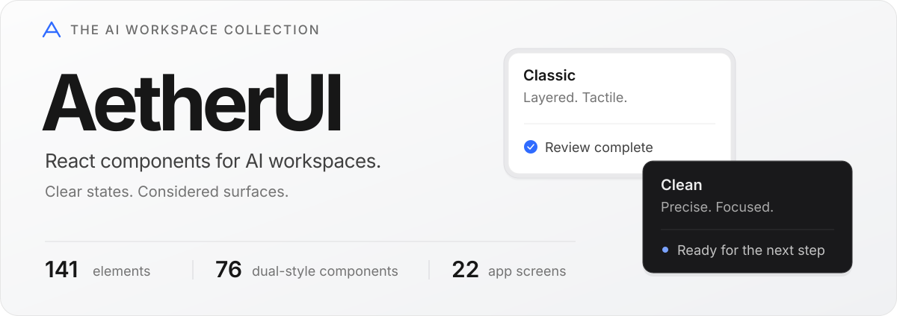
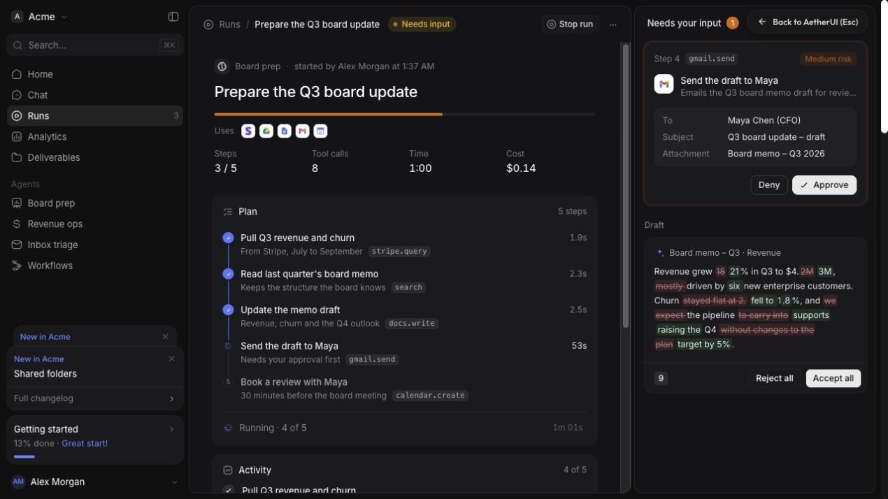
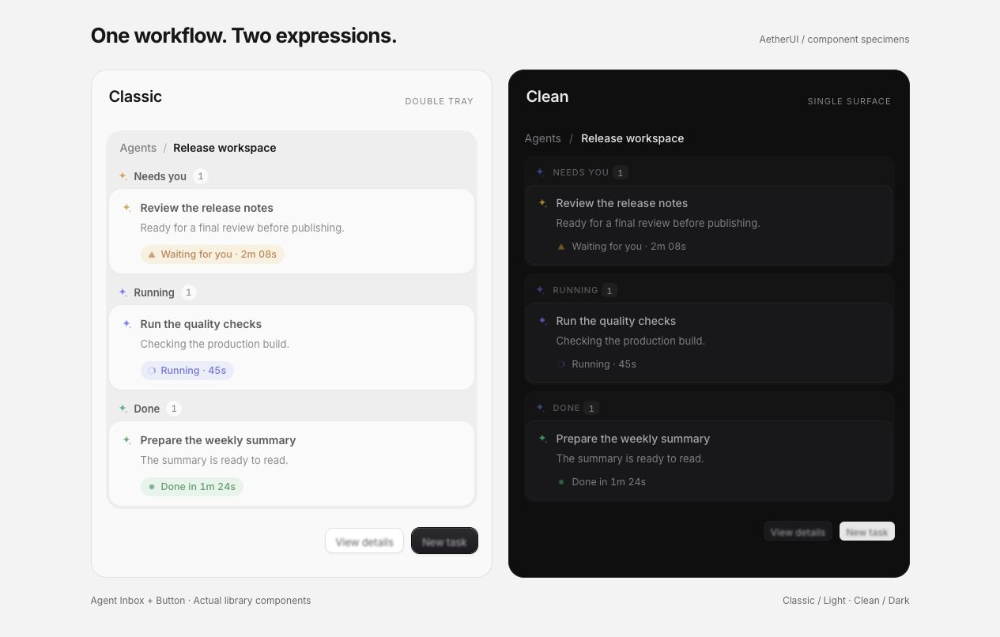

<p align="center">
  
</p>

<p align="center">
  面向 AI 工作台、Agent 协作与企业应用的 React 组件库与设计系统。
  <br>
  从任务审批到执行追踪，让复杂的工作流拥有清晰、一致的界面。
</p>

<p align="center">
  <a href="#快速开始">快速开始</a> &nbsp; · &nbsp;
  <a href="./design-system/README.md">设计规范</a> &nbsp; · &nbsp;
  <a href="#在项目中使用">接入指南</a>
</p>

<br>



<p align="center"><sub>Agent Run · 计划、执行、审批与结果审阅，在同一个工作区内展开。截图为内置演示。</sub></p>

## 一套系统，两种表达

**Classic** 用双层托盘与轻微高光建立层次，适合强调操作反馈的工作台。**Clean** 用单层表面、细边缘与透明度文字收敛视觉，适合信息密集的生产力界面。76 个核心组件均提供两种变体，并配有明暗主题样式。



| 设计维度 | Classic | Clean |
| :--- | :--- | :--- |
| 表面结构 | 下沉托盘 + 内层卡片 | 单层卡片 + 细边缘 |
| 文字层级 | 实色灰阶 | 透明度灰阶 |
| 基准密度 | 14px 字号 / 20px 行高 | 13px 字号 / 20px 行高 |
| 浅色强调色 | `#2F6BFF` | `#0060E2` |

同心圆角、分级表面、等宽数字与统一缓动曲线，构成两种风格共享的设计基础。完整定义见 [设计语言规范](./design-system/README.md) 与 [Design Tokens](./design-system/tokens/design-tokens.json)。

## 组件与场景

目录包含 **183 个 UI 元素**，覆盖单个控件到完整应用页面。

| 资产 | 数量 | 代表内容 |
| :--- | ---: | :--- |
| Components | 76 | Chat Composer、Agent Inbox、Approval Card、Data Table |
| Screens | 22 | Agent Run、AI Chat、CRM、Analytics、Settings |
| Blocks | 11 | AI Workspace、Task Board、Pricing Plans |
| Illustrations | 24 | Voice Orb、Model Wheel、Integration Beam |
| Motion | 8 | Blur Crossfade、Number Ticker、Text Reveal |

**围绕 Agent 的工作过程组织界面：**

- **输入与上下文** — 提示词编辑、模型选择、来源引用、记忆与上下文窗口。
- **规划与协作** — 任务计划、队列、代理树、并行尝试和交接。
- **审批与控制** — 操作审批、权限请求、自主程度与执行中干预。
- **追踪与审阅** — 工具调用、时间瀑布、成本拆解、检查点和内容差异。

可在本地工作台检索全部元素、切换风格与主题、查看 Props 和源码，并预览不同舞台宽度。交互设计说明见 [AI Agent UI Patterns](./design-system/guidelines/AI-AGENT-UI-PATTERNS.md)。

## 快速开始

先启动工作台，浏览组件与内置交互演示。

```bash
git clone https://github.com/opxqo/AetherUI.git
cd AetherUI
npm ci
npm run dev
```

打开终端输出的本地地址，通常为 [localhost:5173](http://localhost:5173)。使用 `⌘K` / `Ctrl+K` 搜索，或从 Components、Screens、Blocks 进入目录。

```bash
npm run build:lib   # 构建独立发布组件库 (dist/lib/)
npm run build:site  # 构建展示站应用 (dist/site/)
npm run build       # 完整构建（组件库 + 展示站）
npm run typecheck   # 校验全量 217 个组件 TypeScript 类型
npm run test        # 运行自动化测试套件
npm run verify      # 全量工程质量与消费者交付验收
npm run preview     # 预览展示站构建结果
```

本地验证环境为 Node.js 22.22.3；支持 Node.js 20.19+ / 22；CLI 不需要模块加载钩子。组件包声明的 React / React DOM peer 版本为 `>=19.0.0`。

## 在项目中使用

### 本地包接入

在目标 React 项目中安装本地目录，路径按实际位置调整：

```bash
npm install ../AetherUI
```

引入样式，再选择组件。以下示例使用 Classic 变体：

```jsx
import "@aether-ui/react/styles.css";
import { AgentInbox } from "@aether-ui/react/ui/agent-inbox";

const tasks = [
  {
    id: "release-review",
    title: "审核发布说明",
    description: "变更已整理，等待人工确认。",
    agent: "Release assistant",
    status: "waiting",
  },
];

export default function ReleaseReview() {
  return (
    <AgentInbox
      title="发布工作区"
      tasks={tasks}
      onApprove={(task) => console.log("Approve", task.id)}
      onReject={(task) => console.log("Reject", task.id)}
    />
  );
}
```

切换 Clean 变体，只需调整组件导入：

```jsx
import { AgentInbox } from "@aether-ui/react/ui/clean/agent-inbox";

// 也可使用聚合入口
import { AgentInbox as ClassicAgentInbox } from "@aether-ui/react";
import { AgentInbox as CleanAgentInbox } from "@aether-ui/react/clean";
```

回调需要连接业务逻辑；示例中的日志不会执行真实审批。普通导出默认渲染业务组件，无数据时请传入组件所需的业务 Props。演示请显式使用 `demo={true}` 或 `*Demo` 导出；`*Raw` 保留底层业务实现。

### CLI 与源码导出

在 AetherUI 目录内运行：

```bash
npm run cli -- list --kind component
npm run cli -- info agent-inbox
npm run cli -- add agent-inbox --clean --dir ../my-app/src/components/ui
npm run cli -- init --dir ../my-app/src/styles
```

`add` 导出组件源码与类型声明；`init` 导出 CSS 变量、JSON Tokens 与 Tailwind preset。`add` 复制规范组件入口、类型契约、运行时适配器、CSS、Tokens 和本地字体，保持 `_engine/` 内的相对目录结构，并自动引用配套样式。宿主仍需安装 React 与 React DOM。使用 `--package` 则生成引用已安装包的轻量入口；请求不存在的 Clean 变体会直接报错。

### Design Tokens

只接入视觉基础时，可以单独导入 Tokens：

```css
@import "@aether-ui/react/tokens.css";
```

需要 Tailwind 配置时，可从 `@aether-ui/react/tailwind` 导入 preset；请按宿主项目的 Tailwind 版本验证配置格式。

## 规范与工程入口

| 入口 | 内容 |
| :--- | :--- |
| [Design System](./design-system/README.md) | 表面、字体、色彩、圆角与动效规范 |
| [Agent UI Patterns](./design-system/guidelines/AI-AGENT-UI-PATTERNS.md) | AI 工作流的交互设计指南 |
| [Prompt Template](./design-system/PROMPT-TEMPLATE.md) | 给 AI 编程助手使用的设计约束 |
| [Brand Config](./src/brand.config.js) | 展示名称、包名、CLI 名称与品牌文案 |
| [Catalog](./src/affectui-engine/catalog.js) | 元素目录、变体、文档与源码加载入口 |
| [组件入口](./src/index.js) · [Clean 入口](./src/clean.js) | 组件导出列表 |

<details>
<summary><strong>目录结构与维护命令</strong></summary>

```text
src/
├── components/ui/     组件包装与类型声明，含 clean/ 变体
├── affectui-engine/   底层组件、样式、演示与文档模块
├── showcase/          本地可视化工作台
├── brand.config.js    品牌配置
└── styles.css         全量组件样式入口
design-system/         设计规范、Tokens 与 Prompt 模板
bin/                   CLI
scripts/               组件生成与品牌配置脚本
assets/readme/         仓库首页视觉素材
```

```bash
# 运行自动化测试与类型检查
npm run typecheck
npm run test
npm run verify

# 独立构建组件库发布产物 (dist/lib/) 与展示站 (dist/site/)
npm run build:lib
npm run build:site

# 更新品牌配置、package.json 元数据与 HTML 标题
npm run rebrand -- --name "YourUI" --pkg "@your-team/react" --cli "your-ui"

# 重新生成组件包装与类型声明
npm run build:tokens
```

</details>

## 行为迁移与验收范围

普通组件现在默认渲染业务实现。此前依赖 `<AgentInbox />` 自动播放演示的代码，需要改为：

```jsx
import { AgentInbox, AgentInboxDemo } from "@aether-ui/react";

// 两种显式演示写法，二选一
<AgentInbox demo />;
<AgentInboxDemo />;

// 业务组件使用真实数据；样式属性不会改变模式
<AgentInbox tasks={tasks} className="workspace-inbox" />;
```

需要必填数据的组件会在类型声明中约束输入；使用示例请查看工作台文档。组件子路径与聚合入口共用同一次库构建，不会产生独立的 Toast 状态。

- **类型检查**：开启严格模式和声明文件检查；覆盖正确业务输入，以及错误状态、回调和组件属性的拒绝场景。
- **SSR 回归**：217 个 Classic / Clean 入口按业务样例渲染，并逐一检查显式 Demo；不注入 `document` 或 `window`。这不等同于已验证所有服务端框架和所有业务数据组合。
- **分发验收**：在仓库外新建 npm 项目安装打包产物，检查包入口、类型、共享状态及代表性 CLI 导出；全部变体检查本地依赖闭包。
- **构建与 CI**：分别输出 `dist/lib` 与 `dist/site`。CI 按类型检查、库构建、测试、外部消费验收、展示站构建的顺序运行。异步步骤完成后才报告通过。

## EdgeOne 部署

仓库的 `edgeone.json` 已明确配置：安装 `npm ci`、构建 `npm run build:site`、输出 `dist/site`。从旧版本迁移时，请同步更新控制台原来的 `dist` 输出目录。无需为纯展示站设置业务密钥。

本仓库配置不代表线上部署已验收；发布后仍需检查首页、组件详情和全屏页面的资源加载与交互。

欢迎通过 [Issues](https://github.com/opxqo/AetherUI/issues) 提交具体场景、复现步骤与改进建议。
